<div align="center">

# Андрей Григорьев — сайт фотографа

**Портфолио, которое ведёт себя как камера.** Рамка автофокуса вместо курсора,
диафрагма переключает тему, а клиенты отбирают кадры прямо в своём альбоме.

### [→ Открыть сайт: andreygrugoriev.ru](https://andreygrugoriev.ru/)


[](https://andreygrugoriev.ru/)

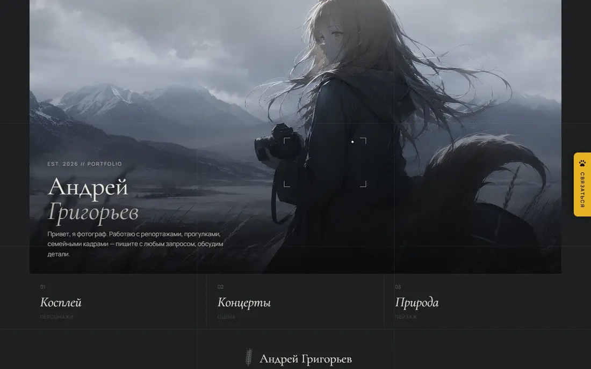

</div>

---

## Чем этот сайт не похож на шаблон

| | |
|---|---|
| **Интерфейс-видоискатель** | Сетка кадра, рамка автофокуса вместо курсора, таймер REC, экспонометр. Всё оформлено как экран камеры, а не как обычный лендинг. |
| **Настройки камеры управляют сайтом** | Диафрагма меняет тему, баланс белого — цветовую температуру, ISO — зерно плёнки. Выбор запоминается. |
| **Клиентские альбомы** | Секретная ссылка, отбор кадров сердечком, «сколько человек отметили», срок хранения и автоудаление, водяной знак до оплаты. |
| **Админка для фотографа** | Видно, какие кадры выбрал клиент, с именами исходных файлов, чтобы найти их среди RAW. Есть проверка дубликатов и место на сервере. |
| **Ни одного внешнего запроса** | Шрифты и библиотеки лежат на своём сервере. По 152-ФЗ IP посетителей не уходит за рубеж. |
| **Каждое решение выбрано из вариантов** | Перед любым изменением дизайна делалось 3–15 прототипов, все они лежат в [`prototypes/`](prototypes/). |

## Содержание

- [Сайт](#сайт): [главная](#главная), [настройки камеры](#настройки-камеры-управляют-сайтом), [галерея](#галерея), [альбом](#альбом), [«Обо мне»](#обо-мне), [детали](#детали-с-характером), [телефон](#на-телефоне)
- [Админка](#админка)
- [Под капотом](#под-капотом)
- [Как делался дизайн](#как-делался-дизайн)
- [Стек, структура, запуск](#стек-и-структура)

---

# Сайт

## Главная

Фото на весь экран внутри рамки видоискателя. Направления съёмки переключают
кадр, а страница плавно перекрашивается в цвет снимка. Рамка автофокуса
следует за курсором и сдвигается только на целые пиксели, поэтому уголки не
перерисовываются в каждом кадре. На телефоне направления листаются сами по
кругу, а после свайпа автопрокрутка ждёт 9 секунд.

## Настройки камеры управляют сайтом

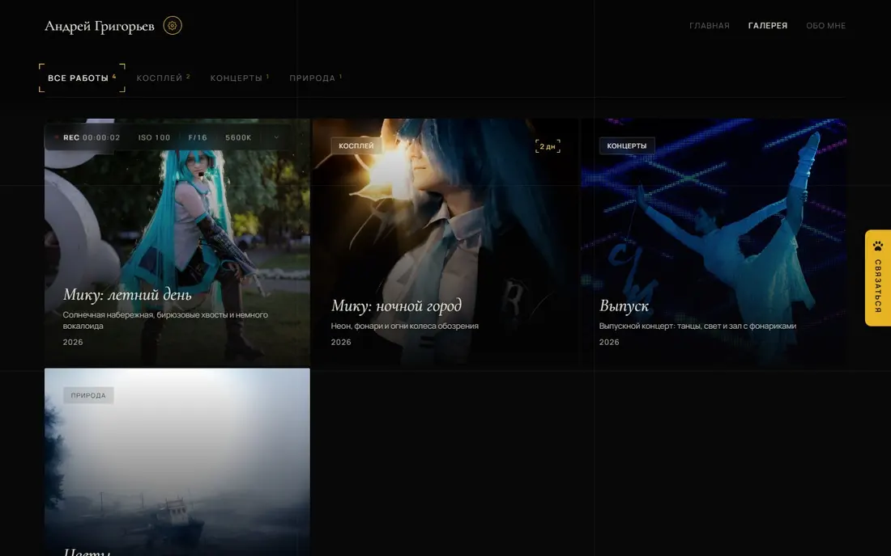

Панель с данными камеры не для красоты: на каждый параметр можно нажать.

| Параметр | Что меняет |
|---|---|
| **F/1.2 · F/8 · F/16** | Светлая, серая или тёмная тема. Сохранённая тема ставится до отрисовки, поэтому страница не мигает. |
| **3200K · 5600K · 7000K** | Тёплый, нейтральный или холодный оттенок поверх страницы. |
| **ISO 100 – 6400** | Сила зерна плёнки. |

## Галерея


- **Фильтры «Фокус-рамка».** Уголки автофокуса «ищут» категорию под курсором, а при выборе вспыхивают.
- **Цвет альбома.** Шапка и фильтры — это одна полоса тёмного стекла, поэтому окрашиваются вместе со страницей.
- **Срок хранения.** Он показан в уголках автофокуса, например «5 дн». Он виден при наведении, а за 3 дня до удаления — всегда и жёлтым. Владелец перебрал десяток вариантов (REC, таймкод, батарея, самоспуск) и выбрал этот за спокойствие.
- **Обложки.** У каждой есть точка фокуса и увеличение, отдельно для ПК и для телефона.

## Альбом

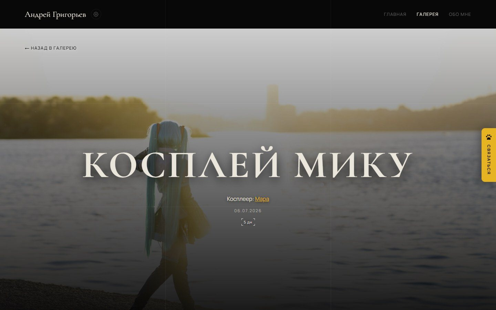

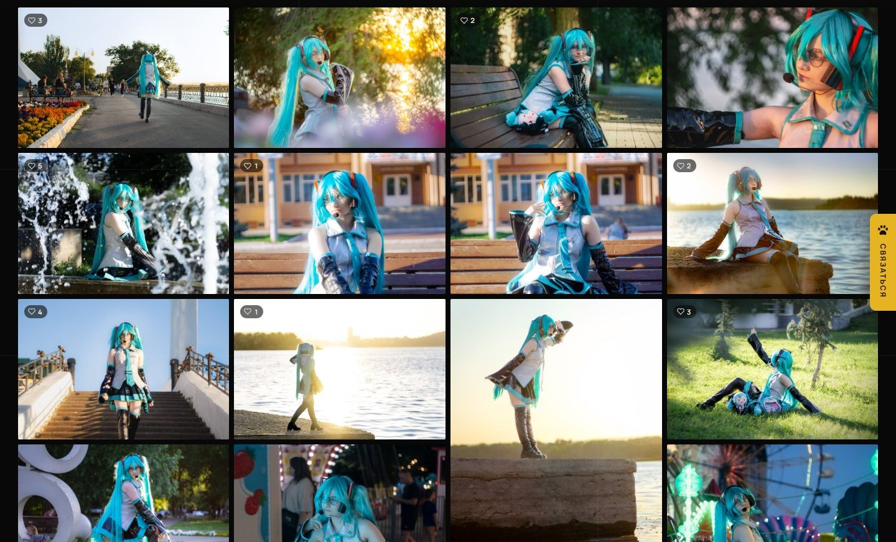

- **Раскладка «кирпичиками».** Снимки идут слева направо, каждый в самую короткую колонку. Это то же правило, что и в админке, поэтому порядок, выставленный перетаскиванием, на сайте точно такой же.
- **Отбор кадров.** Клиент отмечает фото сердечком. В углу видно, сколько человек отметили кадр, но без имён: имена видит только фотограф.
- **«Пустое место».** Невидимая карточка, которой фотограф подгоняет сетку под себя.

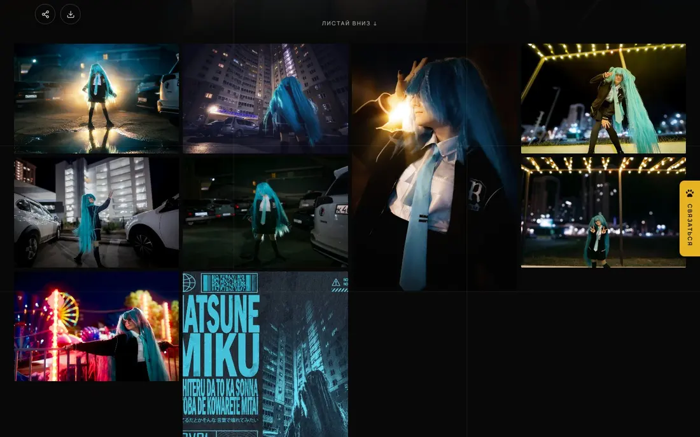

**Лайтбокс:**

- лента миниатюр всего альбома;
- данные съёмки (камера, объектив, выдержка, диафрагма, ISO);
- кнопки «поделиться» и «скачать»;
- режим «только фото» на весь экран, на телефоне — свайпы.

Альбом скачивается архивом. Если включён водяной знак, посетителю отдаются только версии со знаком под случайными именами, а оригиналы закрыты даже по прямой ссылке.

## «Обо мне»

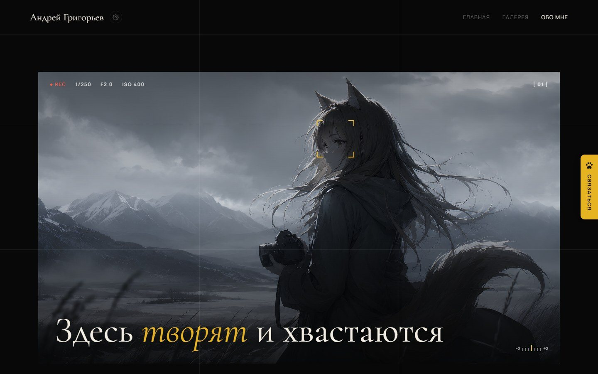

Портрет показан как кадр в видоискателе. Рамку автофокуса фотограф сам ставит
на лицо в админке, отдельно для ПК и для телефона. Встаёт она туда чистым CSS:
точка фокуса картинки и есть координата рамки.

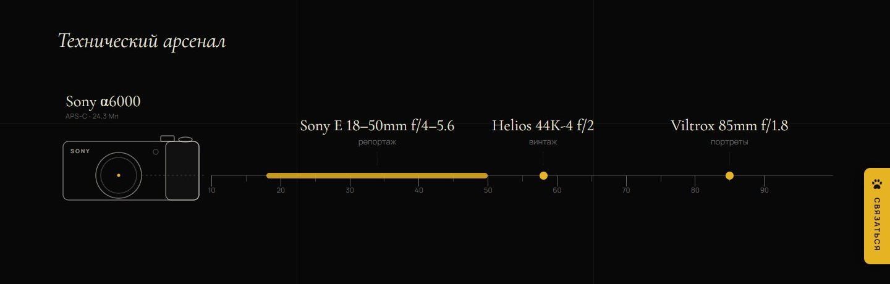

Оборудование показано шкалой фокусных расстояний. На ПК она горизонтальная, а
на телефоне вертикальная и липкая: объективы подсвечиваются при прокрутке. Ниже
идут награды стопкой дипломов и контакты.

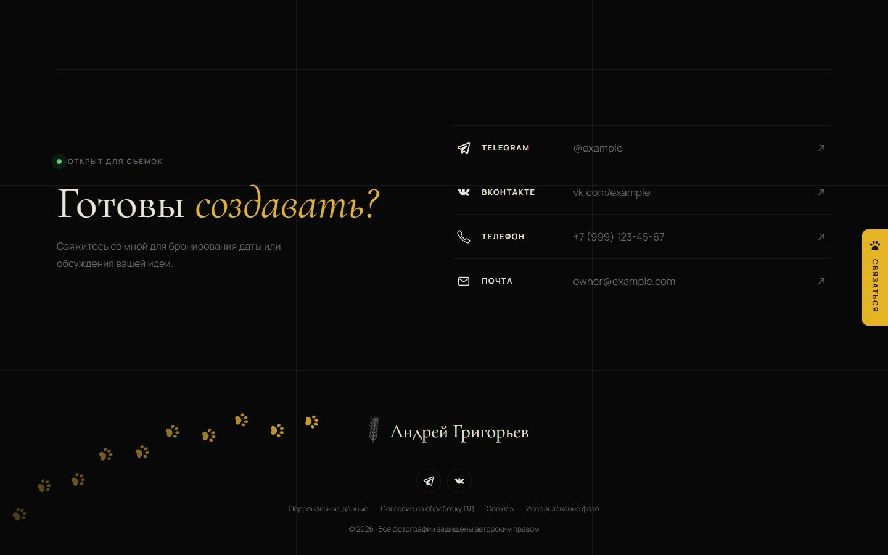

## Детали с характером

<table>
<tr>
<td width="50%">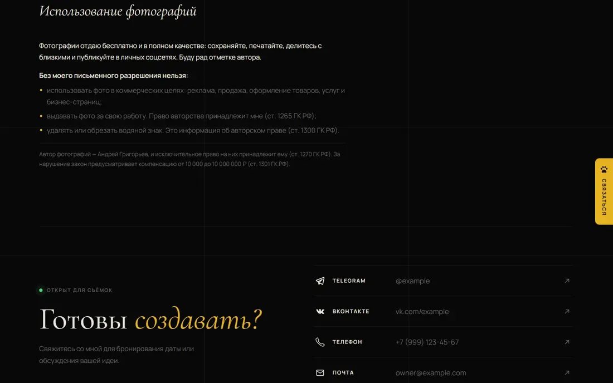</td>
<td width="50%">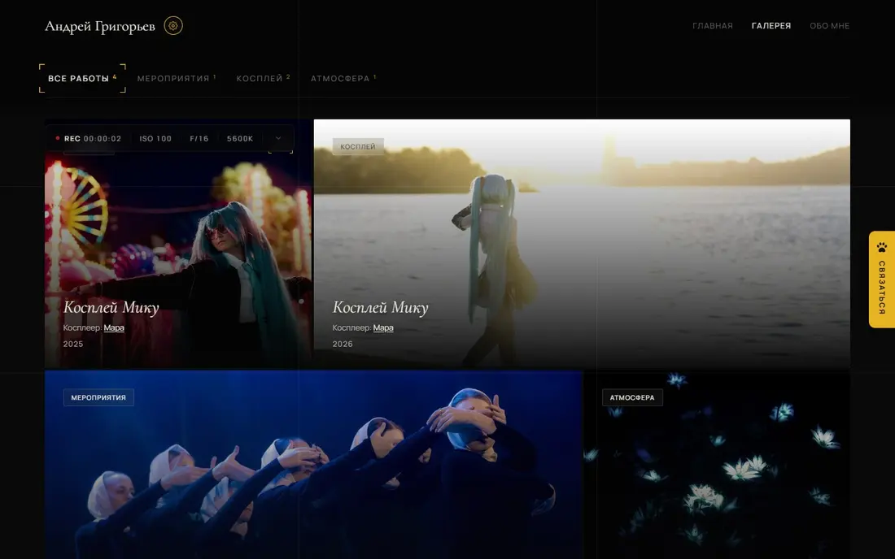</td>
</tr>
<tr>
<td><b>Подвал «Волчий след».</b> Следы лапок бегут к колосу (Хоро — волчица урожая), и он загорается. Нажатие — «Великая волчица наблюдает», и следы идут за курсором по всей странице. Ещё нажатие — волчица гуляет по фону.</td>
<td><b>«Связаться».</b> Язычок с лапкой у края экрана. Шторка с контактами выезжает оттуда же, где нажал, а не всплывает окном по центру.</td>
</tr>
</table>

<div align="center">
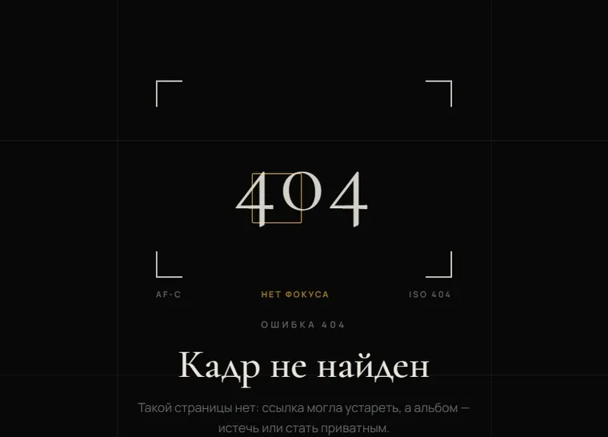

**404 «Нет фокуса».** Рамка автофокуса ищет кадр и не находит. Если упала база
данных, показывается запасная версия, которой база не нужна.
</div>

## На телефоне

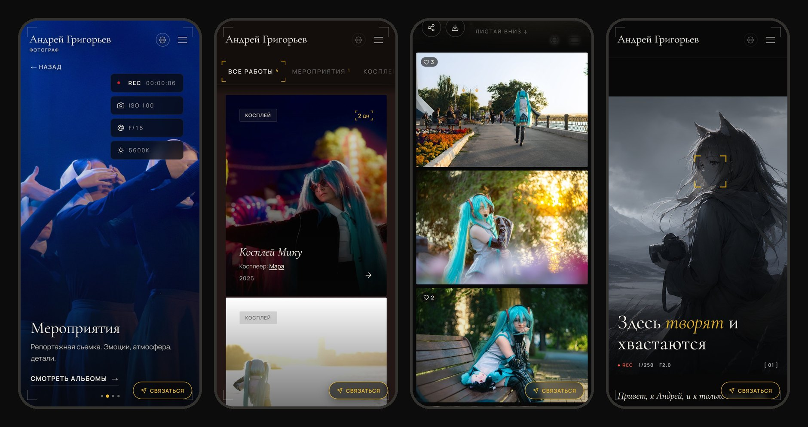

Мобильная версия — не уменьшенный ПК:

- категории листаются свайпом;
- шапка и фильтры галереи закреплены одним стеклянным слоем без шва;
- число отметок видно на самом фото;
- в лайтбоксе работают свайпы.

---

# Админка

<table>
<tr>
<td width="50%">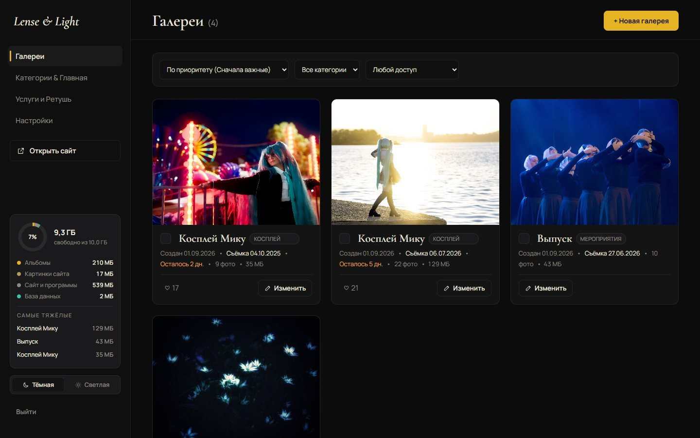</td>
<td width="50%">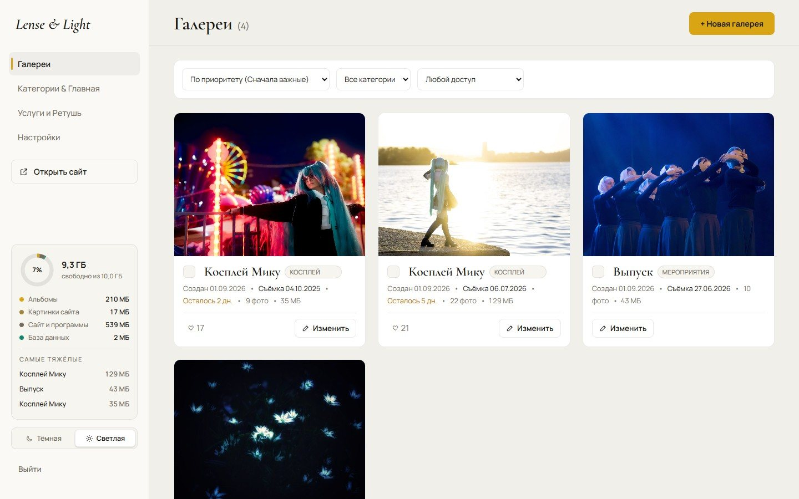</td>
</tr>
</table>

Тёмная «студия» и светлая тема. Вся работа фотографа с сайтом идёт в одном окне.

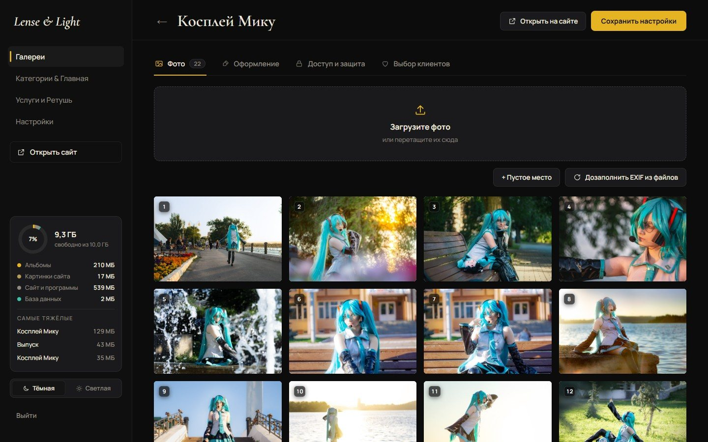

- **Загрузка.** Фото перетаскиваются пачкой. Сайт сам строит миниатюры и мобильные обложки 9:16, подбирает пропорцию для сетки, ставит водяной знак, прописывает автора в метаданные и **удаляет геометки**.
- **Порядок.** Карточки перетаскиваются, и сетка раскладывается так же, как на сайте. Номер можно вписать вручную.
- **Точка фокуса и масштаб** для мобильного кадрирования каждой фотографии.

<table>
<tr>
<td width="55%">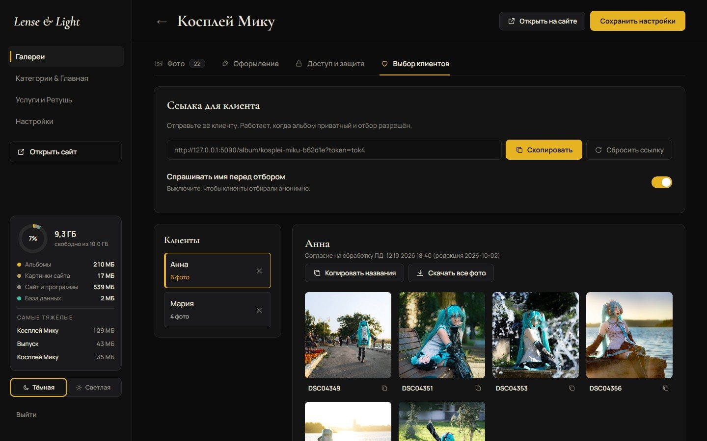</td>
<td width="45%">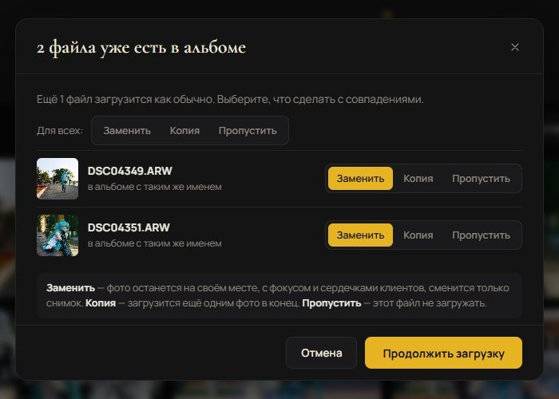</td>
</tr>
<tr>
<td><b>Выбор клиентов.</b> Видно, кто и какие кадры отметил, с точными именами исходных файлов (кириллица сохраняется), чтобы быстро найти их среди RAW. Названия копируются одной кнопкой, отбор скачивается архивом. Рядом отмечено, когда и на какую редакцию текста клиент дал согласие на обработку данных.</td>
<td><b>Дубликаты.</b> Если файл с таким именем уже есть в альбоме, сайт спросит: заменить, загрузить копией или пропустить. При замене остаются место, фокус и сердечки клиентов.</td>
</tr>
</table>

<table>
<tr>
<td width="22%">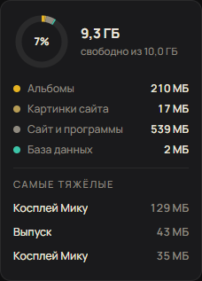</td>
<td><b>Место на сервере.</b> Кольцо показывает, сколько свободно и на что ушло место: альбомы, картинки сайта, программы, база. Под ним — три самых тяжёлых альбома, а вес есть на карточке каждого альбома. Квоту shared-хостинга программа не видит (<code>disk_usage</code> вернёт весь диск сервера), поэтому объём тарифа вписывается в настройках. Права PROCESS для размера файлов MySQL у хостинга нет, и вес базы оценивается по устройству файлов InnoDB.</td>
</tr>
</table>

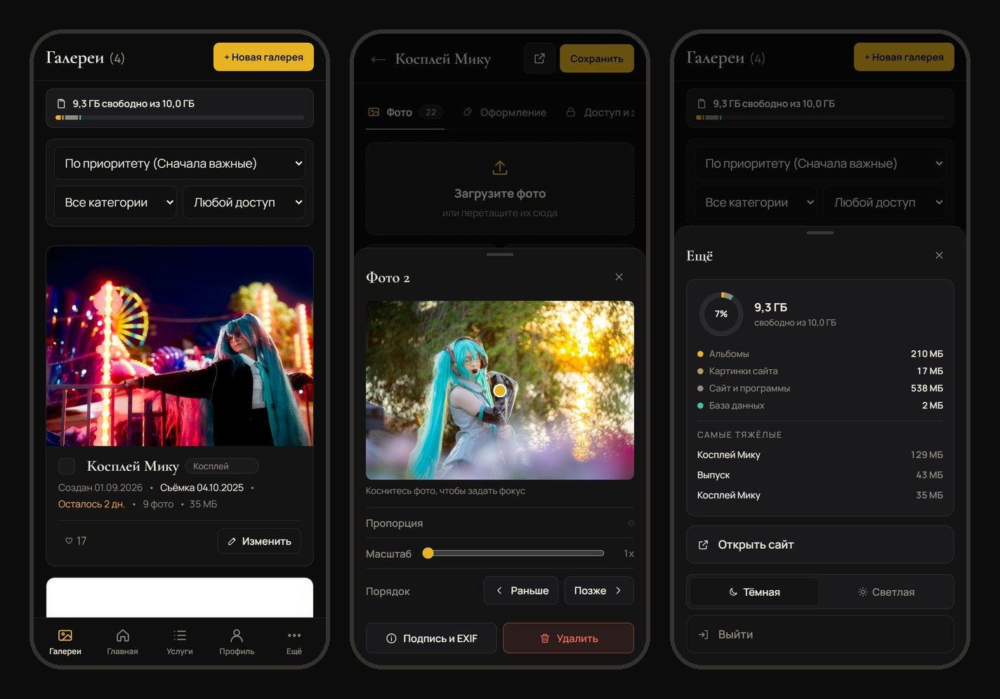

**С телефона** админкой тоже удобно пользоваться: внизу панель разделов, по касанию на фото выезжает шторка (фокус, пропорция, масштаб, порядок, EXIF), а окна открываются снизу.

---

# Под капотом

**Производительность** (проверено трассировкой Chrome на ноутбуке со встроенной графикой):

- за мышью не двигаются полноэкранные слои;
- рамка-курсор сдвигается на целые пиксели;
- «дыхание» сделано прозрачностью вместо бесконечной анимации `filter`;
- после правок пересчётов стилей стало примерно 2 в секунду вместо 90;
- к стилям и скриптам дописывается время изменения файла, поэтому после обновления браузер не держит старую версию.

**Безопасность:**

- после 5 неверных паролей вход с этого IP закрывается на 15 минут, попытки хранятся в БД (у Passenger несколько процессов);
- IP из заголовков прокси принимается только от локального прокси;
- заголовки `nosniff`, `SAMEORIGIN` и `Referrer-Policy`, чтобы токен приватного альбома не утекал;
- после входа редирект только внутри сайта;
- данные из БД и EXIF экранируются в админке;
- превью ссылок (Open Graph) не показывает фото приватных альбомов, а токен в превью не попадает.

**Закон о персональных данных (152-ФЗ):**

- политика конфиденциальности, cookies и отдельное согласие на обработку данных;
- у согласия есть версии: опубликованный текст не правится, и для каждого клиента хранится, какую редакцию он видел;
- ни одного стороннего сервера на страницах.

**Надёжность:**

- просроченные альбомы удаляются ночью, и ещё раз при обычных запросах, не чаще раза в час: Passenger может погасить процесс до ночи;
- у страниц 404 и 500 есть запасной вариант без базы;
- API отвечает JSON, а битые картинки не нагружают базу.

---

# Как делался дизайн

Ни одно визуальное решение не попадало на сайт сразу. Сначала в браузере на
тестовом сайте собирались 3–15 вариантов с буквами, владелец выбирал один, и
только он переносился в проект. Все варианты сохранены:

| Папка | Что выбиралось |
|---|---|
| [`about-hero`](prototypes/about-hero/) | первый экран «Обо мне» (выбран «Кадр») |
| [`about-awards`](prototypes/about-awards/) | награды (выбрана «Стопка») |
| [`site-footer`](prototypes/site-footer/), [`footer-wolf`](prototypes/footer-wolf/) | подвал и колос Хоро |
| [`contact-button`](prototypes/contact-button/) | кнопка «Связаться» |
| [`album-extras`](prototypes/album-extras/) | срок хранения, сердечки, дубликаты |
| [`admin-storage`](prototypes/admin-storage/), [`error-pages`](prototypes/error-pages/) | кольцо памяти, страница 404 |
| [`безумные-идеи`](prototypes/безумные-идеи/) | снятые, но сохранённые идеи (например, 404 «Волчица унесла эту страницу») |

Тестовый сайт [`prototypes/_server/fake_site.py`](prototypes/_server/fake_site.py)
поднимает настоящие шаблоны на выдуманных данных, без MySQL. На нём сняты все
скриншоты этой страницы.

---

# Стек и структура

**Python 3.10 · Flask · MySQL (PyMySQL, без ORM) · Jinja · обычные JS и CSS без сборки · Pillow · APScheduler.**
Хостинг — shared с Passenger.

```
scr/__init__.py        всё серверное приложение: роуты, SQL, обработка фото
scr/templates/         шаблоны страниц
scr/static/            стили, скрипты, свои шрифты; загрузки (uploads/) — только на сервере
db/schema.sql          структура базы (без данных)
db/ГГГГ-ММ-ДД_*.sql    изменения схемы после неё — по порядку дат
prototypes/            прототипы дизайна и тестовый сайт
docs/readme/           картинки этой страницы
```

## Запуск

```bash
pip install -r scr/requirements.txt
cp scr/.env.example scr/.env    # доступ к MySQL и FLASK_SECRET_KEY
cd scr && FLASK_DEBUG=1 python __init__.py
```

Перед первым запуском:

1. Создайте базу из `db/schema.sql` и примените изменения `db/20*.sql`.
2. Добавьте в `grid_class` строки `ratio-hor`, `ratio-ver`, `ratio-sq`.
3. Добавьте админа с `id = 1`.

**Без базы** можно посмотреть вёрстку на тестовом сайте:
`python prototypes/_server/fake_site.py` → http://127.0.0.1:5090 (вход admin / secret).

Точка входа Passenger и `.htaccess` лежат только на сервере. В репозитории —
их образцы `passenger_wsgi.py.example` и `.htaccess.example`.

---

<div align="center">
<sub>Фотографии на скриншотах — работы автора сайта, опубликованы с согласия моделей. Все права на фото защищены.<br>
Скриншоты сняты на тестовой копии: контакты, клиенты и сроки хранения на них выдуманные. Живая версия — <a href="https://andreygrugoriev.ru/">andreygrugoriev.ru</a>.</sub>
</div>
